# Praktikum 6 - JavaScript DOM dan Event Handling

| | |
|---|---|
| **Nama** | Rafa Muhammad Fauzan |
| **NIM** | 312510277 |
| **Kelas** | I251C |
| **Mata Kuliah** | Pemrograman Web (Pertemuan 7) |
| **GitHub** | RafaMuhammadFauzan13 |

## Tujuan Praktikum
1. Memahami DOM sebagai representasi dokumen HTML yang dapat diakses melalui JavaScript.
2. Menggunakan id, class, dan selector CSS untuk memilih elemen HTML.
3. Mengubah teks, atribut, kelas CSS, dan gaya elemen melalui JavaScript.
4. Menangani event pengguna menggunakan `addEventListener()`.
5. Membuat validasi form dan menampilkan pesan sesuai kondisi input.
6. Mengembangkan halaman interaktif dengan minimal tiga fungsi yang berjalan benar.

## Struktur File
```
Lab6Web/
├── README.md
├── screenshots/            # screenshot hasil setiap langkah
├── lab6_dom_event/         # Latihan 1-6 dan Eksperimen Mandiri
│   ├── index.html
│   ├── style.css
│   └── script.js
└── mini_project/           # Form Pendaftaran Workshop
    ├── index.html
    ├── style.css
    └── script.js
```

## Cara Menjalankan
1. Clone atau unduh repository ini.
2. Buka folder `lab6_dom_event` atau `mini_project` di Visual Studio Code.
3. Jalankan `index.html` dengan ekstensi **Live Server** (klik kanan, *Open with Live Server*), atau klik dua kali file `index.html`.
4. Tekan `F12` untuk membuka Developer Tools dan pantau tab **Console**.

---

## Langkah Kerja

### A. Persiapan Praktikum
1. Membuat folder kerja `lab6_dom_event`.
2. Membuat tiga file: `index.html`, `style.css`, dan `script.js`.
3. Menghubungkan CSS dan JavaScript dari `index.html`. Atribut `defer` membuat JavaScript berjalan setelah HTML selesai diparsing, sehingga elemen yang dipilih sudah tersedia.
4. Membuka halaman di browser dan mengaktifkan Developer Tools/Console.
5. Mengerjakan latihan secara bertahap dan memeriksa hasil tiap langkah.

**`index.html`**
```html
<!DOCTYPE html>
<html lang="id">
<head>
 <meta charset="UTF-8">
 <meta name="viewport" content="width=device-width, initial-scale=1.0">
 <title>Praktikum DOM dan Event</title>
 <link rel="stylesheet" href="style.css">
 <script src="script.js" defer></script>
</head>
<body>
 <h1 id="judul">Latihan DOM</h1>
 <p id="pesan">Belum ada tindakan.</p>
 <button id="tombolAksi" type="button">Klik Saya</button>
</body>
</html>
```

**`style.css`**
```css
/* style.css - Praktikum 6 */
```

**`script.js`**
```javascript
// script.js - Praktikum 6
```

**Screenshot hasil:**

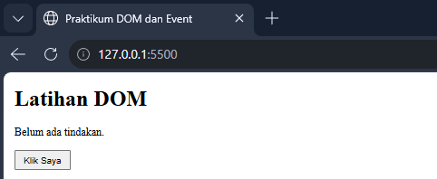

> Tempat screenshot: simpan gambar sebagai `screenshots/persiapan.png`.

### B. Latihan 1 - Mengubah Teks dengan DOM
Memilih `#judul` dan `#pesan` dengan `getElementById()`, lalu mengubah isinya dengan `textContent`.

**`script.js`**
```javascript
const judul = document.getElementById("judul");
const pesan = document.getElementById("pesan");
judul.textContent = "Belajar JavaScript DOM";
pesan.textContent = "Konten berhasil diubah oleh JavaScript.";
```

Hasil: judul berubah menjadi "Belajar JavaScript DOM" dan paragraf menjadi "Konten berhasil diubah oleh JavaScript."

**Screenshot hasil:**

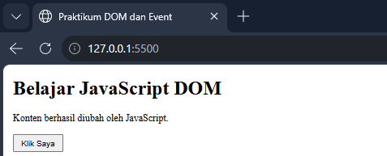

> Tempat screenshot: simpan gambar sebagai `screenshots/latihan1.png`.

### C. Latihan 2 - Event Click
Saat tombol diklik, paragraf menampilkan waktu tindakan dilakukan.

**`script.js`**
```javascript
const tombol = document.getElementById("tombolAksi");
tombol.addEventListener("click", function () {
 pesan.textContent = "Tombol diklik pada " + new Date().toLocaleTimeString();
});
```

**Screenshot hasil:**

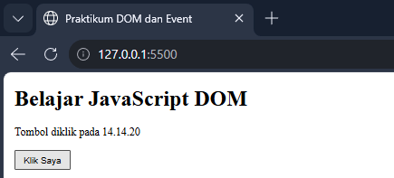

> Tempat screenshot: simpan gambar sebagai `screenshots/latihan2.png`.

### D. Latihan 3 - Mengubah Kelas dan Gaya CSS
`classList.toggle()` menambah atau melepas kelas `highlight` dan `teks-besar`.

**`index.html`**
```html
<h2>Class dan Gaya</h2>
<p id="teksGaya">Teks ini akan berubah gayanya saat tombol ditekan.</p>
<button id="tombolGaya" type="button">Ubah Gaya</button>
```

**`style.css`**
```css
.highlight {
 color: #173f75;
 background-color: #e6f1ff;
 border-left: 4px solid #3478c8;
 padding: 12px;
}
.teks-besar { font-size: 1.4rem; }
```

**`script.js`**
```javascript
const tombolGaya = document.getElementById("tombolGaya");
const teksGaya = document.getElementById("teksGaya");
tombolGaya.addEventListener("click", function () {
 teksGaya.classList.toggle("highlight");
 teksGaya.classList.toggle("teks-besar");
});
```

**Sebelum tombol diklik:**

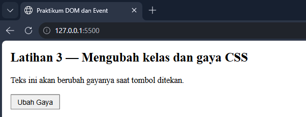

> Tempat screenshot: simpan gambar sebagai `screenshots/latihan3a.png`.

**Sesudah tombol diklik:**

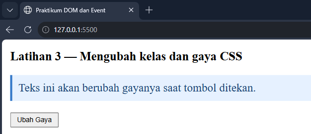

> Tempat screenshot: simpan gambar sebagai `screenshots/latihan3b.png`.

### E. Latihan 4 - Event Input dan Penghitung Karakter
Jumlah karakter diperbarui saat pengguna mengetik.

**`index.html`**
```html
<label for="namaInput">Nama:</label>
<input type="text" id="namaInput" maxlength="40">
<p>Jumlah karakter: <span id="jumlahKarakter">0</span></p>
```

**`script.js`**
```javascript
const namaInput = document.getElementById("namaInput");
const jumlahKarakter = document.getElementById("jumlahKarakter");
namaInput.addEventListener("input", function () {
 jumlahKarakter.textContent = namaInput.value.length;
});
```

**Screenshot hasil:**

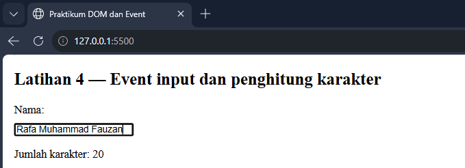

> Tempat screenshot: simpan gambar sebagai `screenshots/latihan4.png`.

### F. Latihan 5 - Validasi Form Pendaftaran
`preventDefault()` mencegah halaman dimuat ulang, lalu data diperiksa berurutan: nama kosong, format email, usia 17-100, dan valid

**`index.html`**
```html
<form id="formPendaftaran" novalidate>
 <label for="nama">Nama lengkap</label>
 <input id="nama" name="nama" type="text">
 <label for="email">Email</label>
 <input id="email" name="email" type="email">
 <label for="usia">Usia</label>
 <input id="usia" name="usia" type="number" min="17" max="100">
 <button type="submit">Daftar</button>
</form>
<p id="pesanForm" aria-live="polite"></p>
```

**`script.js`**
```javascript
const form = document.getElementById("formPendaftaran");
const pesanForm = document.getElementById("pesanForm");
form.addEventListener("submit", function (event) {
 event.preventDefault();
 const nama = document.getElementById("nama").value.trim();
 const email = document.getElementById("email").value.trim();
 const usiaInput = document.getElementById("usia").value;
 const usia = Number(usiaInput);
 const polaEmail = /^[^\s@]+@[^\s@]+\.[^\s@]+$/;

 if (nama === "") {
 pesanForm.textContent = "Nama wajib diisi.";
 } else if (!polaEmail.test(email)) {
 pesanForm.textContent = "Masukkan email yang valid.";
 } else if (usiaInput === "" || !Number.isInteger(usia) || usia < 17 || usia > 100) {
 pesanForm.textContent = "Usia harus berupa bilangan bulat 17–100.";
 } else {
 pesanForm.textContent = "Validasi berhasil. Form siap diproses.";
 form.reset();
 }
});
```

**Screenshot - semua kosong:**

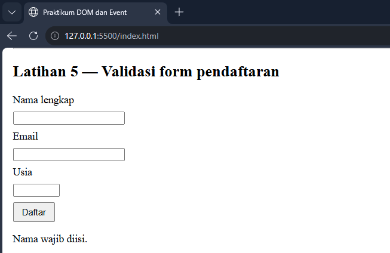

> Tempat screenshot: simpan gambar sebagai `screenshots/latihan5_kosong.png`.

**Screenshot - nama kosong:**

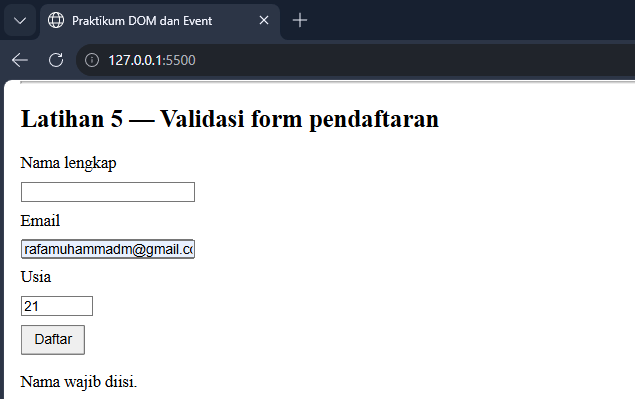

> Tempat screenshot: simpan gambar sebagai `screenshots/latihan5_nama.png`.

**Screenshot - email tidak valid:**

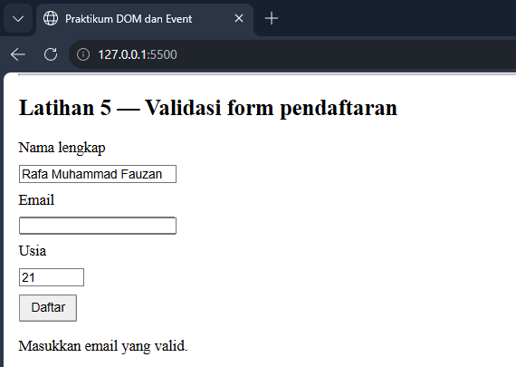

> Tempat screenshot: simpan gambar sebagai `screenshots/latihan5_email.png`.

**Screenshot - usia di bawah 17:**

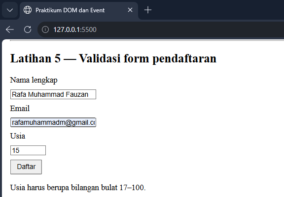

> Tempat screenshot: simpan gambar sebagai `screenshots/latihan5_usia.png`.

**Screenshot - semua valid:**

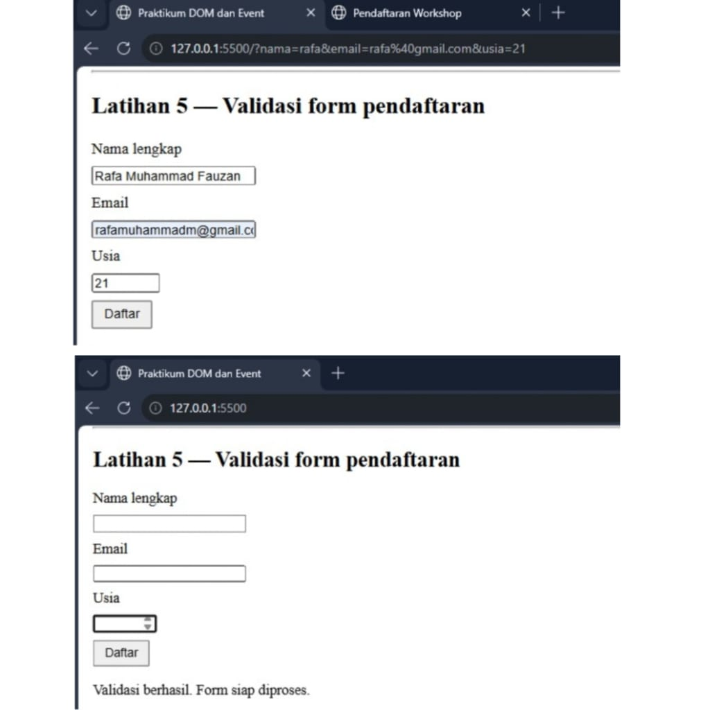

> Tempat screenshot: simpan gambar sebagai `screenshots/latihan5_valid.png`.

### G. Latihan 6 - Daftar Tugas (To-do List)
Tugas dibuat dengan `createElement()` dan `append()`. Teks pengguna ditampilkan dengan `textContent`, bukan `innerHTML`.

**`index.html`**
```html
<section>
 <h2>Daftar Tugas</h2>
 <label for="inputTugas">Tugas baru</label>
 <input id="inputTugas" type="text">
 <button id="tambahTugas" type="button">Tambah</button>
 <p id="pesanTugas" aria-live="polite"></p>
 <ul id="daftarTugas"></ul>
</section>
```

**`style.css`**
```css
.selesai span { text-decoration: line-through; color: #687386; }
li { margin-bottom: 8px; }
li button { display: inline-block; margin-top: 0; margin-left: 6px; }
```

**`script.js`**
```javascript
const inputTugas = document.getElementById("inputTugas");
const tambahTugas = document.getElementById("tambahTugas");
const daftarTugas = document.getElementById("daftarTugas");
const pesanTugas = document.getElementById("pesanTugas");

tambahTugas.addEventListener("click", function () {
 const teks = inputTugas.value.trim();
 if (teks === "") {
  pesanTugas.textContent = "Tulis tugas terlebih dahulu.";
  return;
 }

 const item = document.createElement("li");
 const label = document.createElement("span");
 const selesai = document.createElement("button");
 const hapus = document.createElement("button");

 label.textContent = teks + " ";

 selesai.type = "button";
 selesai.textContent = "Tandai selesai";
 selesai.addEventListener("click", function () {
  item.classList.toggle("selesai");
  selesai.textContent = item.classList.contains("selesai")
   ? "Batalkan selesai" : "Tandai selesai";
 });

 daftarTugas.appendChild(item);
 inputTugas.value = "";
 pesanTugas.textContent = "Tugas ditambahkan.";
 inputTugas.focus();
});
```

**Screenshot - tugas ditambahkan dan ditandai selesai:**

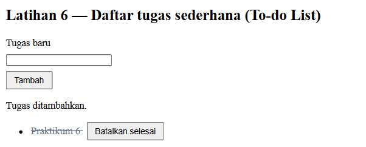

> Tempat screenshot: simpan gambar sebagai `screenshots/latihan6.png`.

---

## Mini Project - Form Pendaftaran Workshop
Folder `mini_project` berisi halaman pendaftaran workshop dengan fitur interaktif: (1) validasi nama, email, dan sesi; (2) ringkasan input langsung; (3) event `change` pada dropdown sesi; (4) penghitung karakter catatan; (5) pesan sukses dan error; (6) tombol "Hapus isian". Tampilan responsif untuk desktop dan mobile.

### `mini_project/index.html`
```html
<!DOCTYPE html>
<html lang="id">
<head>
 <meta charset="UTF-8">
 <meta name="viewport" content="width=device-width, initial-scale=1.0">
 <title>Pendaftaran Workshop</title>
 <link rel="stylesheet" href="style.css">
 <script src="script.js" defer></script>
</head>
<body>
 <main class="kartu">
  <h1>Pendaftaran Workshop Web</h1>
  <p class="intro">Isi data di bawah ini untuk mengamankan kursi kamu.</p>

  <form id="formWorkshop" novalidate>
   <div class="bidang">
    <label for="nama">Nama lengkap</label>
    <input id="nama" name="nama" type="text" autocomplete="name">
    <p class="error" id="errNama" aria-live="polite"></p>
   </div>

   <div class="bidang">
    <label for="email">Email</label>
    <input id="email" name="email" type="email" autocomplete="email">
    <p class="error" id="errEmail" aria-live="polite"></p>
   </div>

   <div class="bidang">
    <label for="sesi">Sesi workshop</label>
    <select id="sesi" name="sesi">
     <option value="">-- Pilih sesi --</option>
     <option value="HTML dan CSS Dasar">Sesi 1: HTML dan CSS Dasar (Senin, 09.00)</option>
     <option value="JavaScript DOM">Sesi 2: JavaScript DOM (Rabu, 13.00)</option>
     <option value="Web Responsif">Sesi 3: Web Responsif (Jumat, 10.00)</option>
    </select>
    <p class="info" id="infoSesi"></p>
    <p class="error" id="errSesi" aria-live="polite"></p>
   </div>

   <div class="bidang">
    <label for="catatan">Catatan (opsional)</label>
    <textarea id="catatan" name="catatan" rows="3" maxlength="100"></textarea>
    <p class="info"><span id="hitungCatatan">0</span>/100 karakter</p>
   </div>

   <section class="ringkasan" aria-live="polite">
    <h2>Ringkasan</h2>
    <p>Nama: <strong id="ringNama">-</strong></p>
    <p>Email: <strong id="ringEmail">-</strong></p>
    <p>Sesi: <strong id="ringSesi">-</strong></p>
   </section>

   <p id="pesanForm" class="pesan" aria-live="polite"></p>

   <div class="aksi">
    <button type="submit" class="utama">Daftar sekarang</button>
    <button type="button" id="tombolReset">Hapus isian</button>
   </div>
  </form>
 </main>
</body>
</html>
```

### `mini_project/style.css`
```css
/* style.css - Mini Project Praktikum 6 */
* { box-sizing: border-box; }

body {
 font-family: "Segoe UI", Arial, sans-serif;
 background: #eef3f9;
 color: #1d2733;
 margin: 0;
 padding: 24px 16px;
}

.kartu {
 max-width: 520px;
 margin: 0 auto;
 background: #fff;
 border: 1px solid #d5dfeb;
 border-radius: 10px;
 padding: 28px 24px;
}

h1 { margin: 0 0 4px; font-size: 1.5rem; color: #173f75; }
h2 { margin: 0 0 8px; font-size: 1rem; }
.intro { margin: 0 0 20px; color: #5a6778; }

.bidang { margin-bottom: 16px; }
label { display: block; font-weight: 600; margin-bottom: 6px; }

input, select, textarea {
 width: 100%;
 padding: 10px;
 font: inherit;
 border: 1px solid #aebdd0;
 border-radius: 6px;
 background: #fff;
}
input:focus, select:focus, textarea:focus, button:focus-visible {
 outline: 3px solid #9cc4f2;
 outline-offset: 1px;
}

.invalid { border-color: #c0392b; background: #fff6f5; }
.valid { border-color: #2e8b57; }

.error { color: #c0392b; margin: 6px 0 0; min-height: 1em; font-size: 0.9rem; }
.info { color: #5a6778; margin: 6px 0 0; font-size: 0.9rem; }

.ringkasan {
 background: #e6f1ff;
 border-left: 4px solid #3478c8;
 border-radius: 4px;
 padding: 12px 14px;
 margin-bottom: 16px;
}
.ringkasan p { margin: 4px 0; overflow-wrap: anywhere; }

.pesan { margin: 0 0 12px; font-weight: 600; }
.pesan.sukses { color: #1e7a46; background: #e8f6ee; padding: 10px; border-radius: 6px; }
.pesan.gagal { color: #c0392b; }

.aksi { display: flex; gap: 10px; flex-wrap: wrap; }
button {
 padding: 10px 16px;
 font: inherit;
 border: 1px solid #aebdd0;
 border-radius: 6px;
 background: #fff;
 cursor: pointer;
}
button.utama { background: #173f75; border-color: #173f75; color: #fff; }

@media (max-width: 480px) {
 .kartu { padding: 20px 16px; }
 .aksi button { width: 100%; }
}
```

### `mini_project/script.js`
```javascript
// script.js - Mini Project Praktikum 6: Form Pendaftaran Workshop

const form = document.getElementById("formWorkshop");
const inputNama = document.getElementById("nama");
const inputEmail = document.getElementById("email");
const pilihSesi = document.getElementById("sesi");
const catatan = document.getElementById("catatan");
const tombolReset = document.getElementById("tombolReset");

const errNama = document.getElementById("errNama");
const errEmail = document.getElementById("errEmail");
const errSesi = document.getElementById("errSesi");
const infoSesi = document.getElementById("infoSesi");
const hitungCatatan = document.getElementById("hitungCatatan");
const pesanForm = document.getElementById("pesanForm");

const ringNama = document.getElementById("ringNama");
const ringEmail = document.getElementById("ringEmail");
const ringSesi = document.getElementById("ringSesi");

const polaEmail = /^[^\s@]+@[^\s@]+\.[^\s@]+$/;

// Menandai kolom valid / tidak valid
function tandai(elemen, pesanError, elemenError) {
 elemenError.textContent = pesanError;
 elemen.classList.toggle("invalid", pesanError !== "");
 elemen.classList.toggle("valid", pesanError === "");
}

// Fungsi validasi per kolom (mengembalikan teks error, "" jika valid)
function cekNama() {
 const nilai = inputNama.value.trim();
 if (nilai === "") return "Nama wajib diisi.";
 if (nilai.length < 3) return "Nama minimal 3 karakter.";
 return "";
}
function cekEmail() {
 const nilai = inputEmail.value.trim();
 if (nilai === "") return "Email wajib diisi.";
 if (!polaEmail.test(nilai)) return "Masukkan email yang valid, contoh: nama@email.com.";
 return "";
}
function cekSesi() {
 return pilihSesi.value === "" ? "Pilih salah satu sesi workshop." : "";
}

// Fitur 1: ringkasan input langsung (event input)
function perbaruiRingkasan() {
 ringNama.textContent = inputNama.value.trim() || "-";
 ringEmail.textContent = inputEmail.value.trim() || "-";
 ringSesi.textContent = pilihSesi.value || "-";
}

inputNama.addEventListener("input", function () {
 perbaruiRingkasan();
 if (inputNama.classList.contains("invalid")) tandai(inputNama, cekNama(), errNama);
});
inputEmail.addEventListener("input", function () {
 perbaruiRingkasan();
 if (inputEmail.classList.contains("invalid")) tandai(inputEmail, cekEmail(), errEmail);
});

// Validasi saat pengguna selesai mengisi satu kolom
inputNama.addEventListener("blur", function () { tandai(inputNama, cekNama(), errNama); });
inputEmail.addEventListener("blur", function () { tandai(inputEmail, cekEmail(), errEmail); });

// Fitur 2: event change pada dropdown sesi
pilihSesi.addEventListener("change", function () {
 perbaruiRingkasan();
 infoSesi.textContent = pilihSesi.value ? "Sesi dipilih: " + pilihSesi.value : "";
 tandai(pilihSesi, cekSesi(), errSesi);
});

// Fitur 3: penghitung karakter catatan
catatan.addEventListener("input", function () {
 hitungCatatan.textContent = catatan.value.length;
});

// Fitur 4: validasi saat submit + pesan sukses / gagal
form.addEventListener("submit", function (event) {
 event.preventDefault();

 const eNama = cekNama();
 const eEmail = cekEmail();
 const eSesi = cekSesi();
 tandai(inputNama, eNama, errNama);
 tandai(inputEmail, eEmail, errEmail);
 tandai(pilihSesi, eSesi, errSesi);

 pesanForm.className = "pesan";
 if (eNama || eEmail || eSesi) {
  pesanForm.textContent = "Pendaftaran belum berhasil. Perbaiki kolom yang bertanda merah.";
  pesanForm.classList.add("gagal");
  return;
 }

 const nama = inputNama.value.trim();
 const sesi = pilihSesi.value;
 pesanForm.textContent = "Terima kasih, " + nama + ". Kamu terdaftar di sesi " + sesi + ".";
 pesanForm.classList.add("sukses");
 bersihkanForm(false);
});

// Fitur 5: tombol reset / hapus isian
function bersihkanForm(hapusPesan) {
 form.reset();
 [inputNama, inputEmail, pilihSesi].forEach(function (el) {
  el.classList.remove("invalid", "valid");
 });
 errNama.textContent = "";
 errEmail.textContent = "";
 errSesi.textContent = "";
 infoSesi.textContent = "";
 hitungCatatan.textContent = "0";
 perbaruiRingkasan();
 if (hapusPesan) {
  pesanForm.textContent = "";
  pesanForm.className = "pesan";
 }
}
tombolReset.addEventListener("click", function () { bersihkanForm(true); });
```

**Screenshot hasil:**

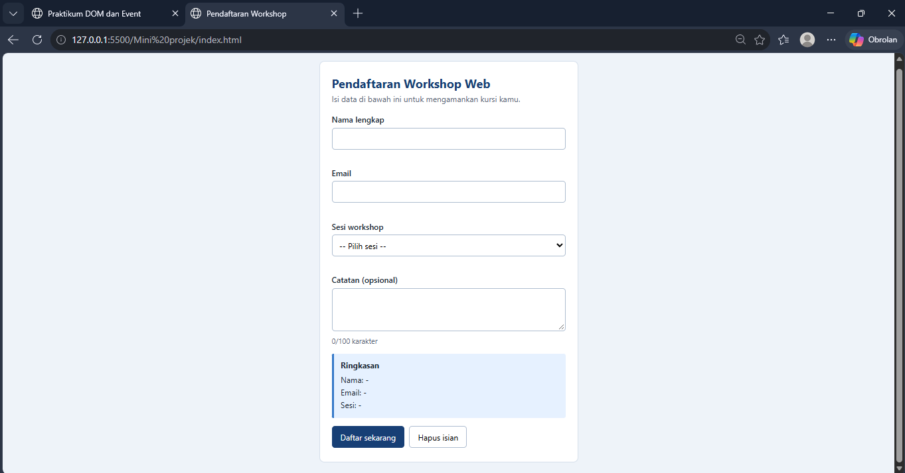

> Tempat screenshot: simpan gambar sebagai `screenshots/mini_kosong.png`.

**Screenshot hasil:**

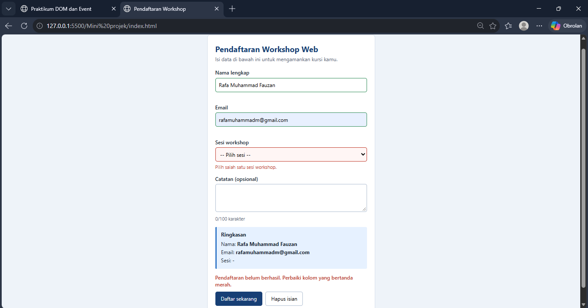

> Tempat screenshot: simpan gambar sebagai `screenshots/mini_error.png`.

**Screenshot hasil:**

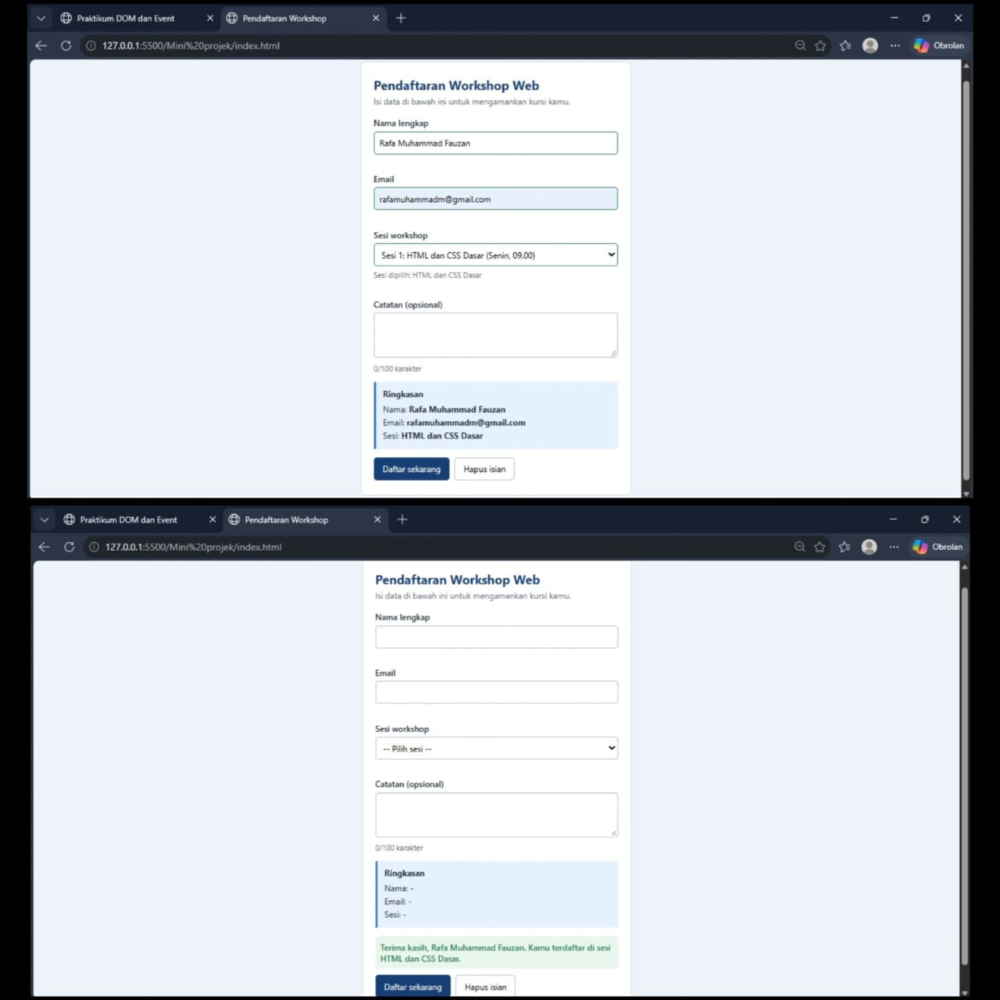

> Tempat screenshot: simpan gambar sebagai `screenshots/mini_sukses.png`.

**Screenshot hasil:**

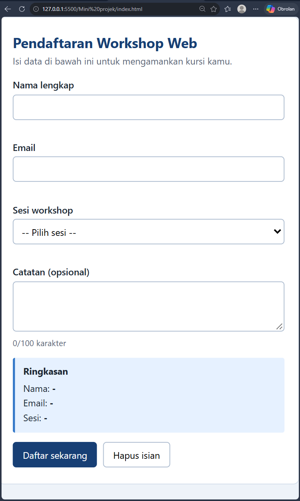

> Tempat screenshot: simpan gambar sebagai `screenshots/mini_mobile.png`.

---

## Eksperimen Mandiri

### Eksperimen 1 - Tombol hapus satu item To-do List
Setiap item mendapat tombol "Hapus" yang memanggil `item.remove()` (kode lengkap ada pada Latihan 6).

```javascript
const hapus = document.createElement("button");
hapus.type = "button";
hapus.textContent = "Hapus";
hapus.addEventListener("click", function () {
 item.remove();
 pesanTugas.textContent = "Tugas dihapus.";
});

item.append(label, selesai, hapus);
```

**Screenshot hasil:**

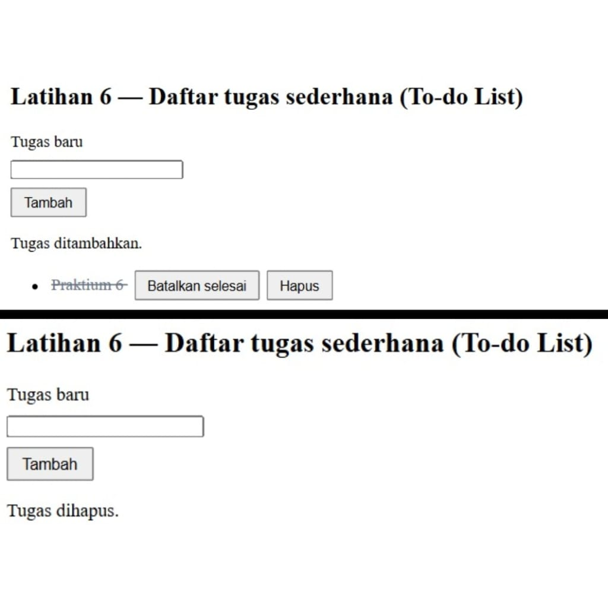

> Tempat screenshot: simpan gambar sebagai `screenshots/eksperimen1.png`.

### Eksperimen 2 - Nama minimal tiga karakter
Ditambahkan cabang `else if (nama.length < 3)` setelah pengecekan nama kosong (kode lengkap ada pada Latihan 5).

```javascript
if (nama === "") {
 pesanForm.textContent = "Nama wajib diisi.";
} else if (nama.length < 3) {
 pesanForm.textContent = "Nama minimal 3 karakter.";
} else if (!polaEmail.test(email)) {
 // ...pengecekan berikutnya
}
```

**Screenshot hasil:**

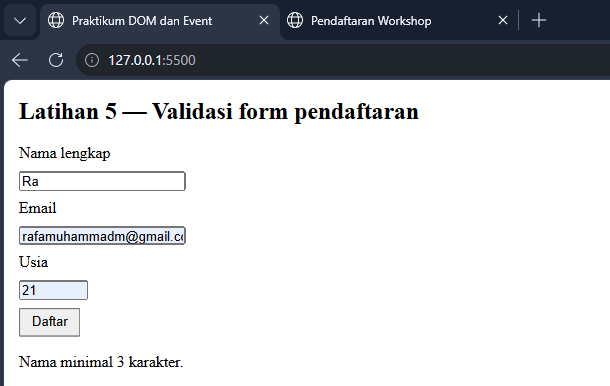

> Tempat screenshot: simpan gambar sebagai `screenshots/eksperimen2.png`.

### Eksperimen 3 - Event `change` pada dropdown sesi workshop
Diterapkan di mini project: memilih sesi menampilkan sesi yang dipilih.

```html
<select id="sesi" name="sesi">
 <option value="">-- Pilih sesi --</option>
 <option value="HTML dan CSS Dasar">Sesi 1: HTML dan CSS Dasar (Senin, 09.00)</option>
 <option value="JavaScript DOM">Sesi 2: JavaScript DOM (Rabu, 13.00)</option>
 <option value="Web Responsif">Sesi 3: Web Responsif (Jumat, 10.00)</option>
</select>
<p class="info" id="infoSesi"></p>
```

```javascript
pilihSesi.addEventListener("change", function () {
 perbaruiRingkasan();
 infoSesi.textContent = pilihSesi.value ? "Sesi dipilih: " + pilihSesi.value : "";
 tandai(pilihSesi, cekSesi(), errSesi);
});
```

**Screenshot hasil:**

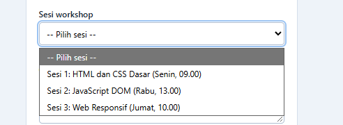

> Tempat screenshot: simpan gambar sebagai `screenshots/eksperimen3.png`.

### Eksperimen 4 - Sembunyikan dan tampilkan paragraf dengan class CSS

**`index.html`**
```html
<h2>Sembunyikan / Tampilkan Paragraf</h2>
<p id="paragrafToggle">Paragraf ini bisa disembunyikan dan ditampilkan lagi dengan tombol di bawahnya.</p>
<button id="tombolToggle" type="button">Sembunyikan Paragraf</button>
```

**`style.css`**
```css
.tersembunyi { display: none; }
```

**`script.js`**
```javascript
const paragrafToggle = document.getElementById("paragrafToggle");
const tombolToggle = document.getElementById("tombolToggle");
tombolToggle.addEventListener("click", function () {
 paragrafToggle.classList.toggle("tersembunyi");
 tombolToggle.textContent = paragrafToggle.classList.contains("tersembunyi")
  ? "Tampilkan Paragraf" : "Sembunyikan Paragraf";
});
```

**Screenshot - paragraf tampil:**

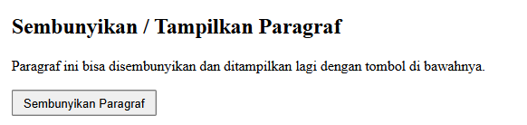

> Tempat screenshot: simpan gambar sebagai `screenshots/eksperimen4a.png`.

**Screenshot - paragraf disembunyikan:**

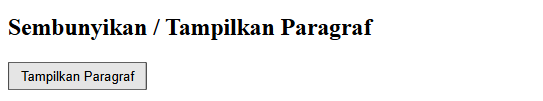

> Tempat screenshot: simpan gambar sebagai `screenshots/eksperimen4b.png`.

### Eksperimen 5 - Script tanpa `defer` di bagian `<head>`
Tag script dipindahkan ke `<head>` tanpa atribut `defer`:

```html
<head>
 <meta charset="UTF-8">
 <title>Praktikum DOM dan Event</title>
 <link rel="stylesheet" href="style.css">
 <script src="script.js"></script> <!-- tanpa defer -->
</head>
```

- **Yang terjadi:** halaman tampil tanpa efek JavaScript, dan Console menampilkan error seperti `Uncaught TypeError: Cannot set properties of null (setting 'textContent')`.
- **Penyebab:** browser membaca HTML dari atas ke bawah. Script di `<head>` berjalan sebelum elemen di `<body>` dibuat, sehingga `document.getElementById("judul")` mengembalikan `null`. Operasi pada `null` menimbulkan error, dan script berhenti sehingga semua kode setelahnya tidak berjalan.
- **Solusi:** pakai `defer`, letakkan script sebelum `</body>`, atau bungkus kode dengan event `DOMContentLoaded`.

**Screenshot - error di Console:**

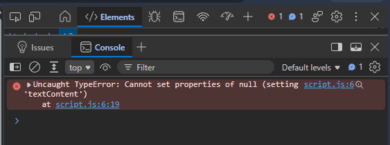

> Tempat screenshot: simpan gambar sebagai `screenshots/eksperimen5.png`.

---

## Pengujian Validasi Form

| No | Skenario | Input | Hasil yang diharapkan |
|---|---|---|---|
| 1 | Semua kosong | (kosong) | "Nama wajib diisi." |
| 2 | Nama kosong | email dan usia terisi | "Nama wajib diisi." |
| 3 | Nama terlalu pendek | "Ra" | "Nama minimal 3 karakter." |
| 4 | Email tidak valid | "rafamuhammadm@" | "Masukkan email yang valid." |
| 5 | Usia di bawah 17 | 15 | "Usia harus berupa bilangan bulat 17–100." |
| 6 | Usia desimal | 20.5 | "Usia harus berupa bilangan bulat 17–100." |
| 7 | Semua valid | "Rafa Muhammad Fauzan", "rafamuhammadm@email.com", 21 | "Validasi berhasil. Form siap diproses." |

## Jawaban Pertanyaan Evaluasi

**1. Apa yang dimaksud dengan DOM dan apa manfaatnya?**
DOM (Document Object Model) adalah representasi struktur dokumen HTML dalam bentuk pohon objek yang dapat diakses dan diubah oleh JavaScript. Manfaatnya, program dapat memilih elemen, mengubah teks, atribut, dan gaya, menambah atau menghapus elemen, serta merespons tindakan pengguna tanpa memuat ulang halaman.

**2. Apa perbedaan `getElementById()`, `querySelector()`, dan `querySelectorAll()`?**
- `getElementById("x")` memilih satu elemen berdasarkan id dan mengembalikan elemen itu (atau `null`).
- `querySelector(selector)` memilih **elemen pertama** yang cocok dengan selector CSS (misalnya `#id`, `.kelas`, `p`).
- `querySelectorAll(selector)` memilih **semua** elemen yang cocok dan mengembalikan `NodeList` yang bisa diulang dengan `forEach`.

**3. Apa fungsi `addEventListener()` dan sebutkan tiga contoh event?**
`addEventListener()` menghubungkan sebuah event pada elemen dengan fungsi yang dijalankan saat event itu terjadi, dan satu elemen bisa punya beberapa listener. Contoh event: `click`, `input`, `submit` (juga `change`, `keydown`, `mouseover`).

**4. Mengapa `event.preventDefault()` digunakan pada event submit form?**
Perilaku bawaan form saat disubmit adalah mengirim data dan memuat ulang halaman. `preventDefault()` membatalkan perilaku itu agar JavaScript sempat memeriksa data dan menampilkan pesan validasi tanpa halaman ter-reload dan tanpa kehilangan isian.

**5. Apa perbedaan `textContent` dan `innerHTML` dari sisi penggunaan dan keamanan?**
- `textContent` membaca atau menulis **teks biasa**. Tag HTML yang dimasukkan ditampilkan apa adanya sebagai teks.
- `innerHTML` membaca atau menulis **markup HTML**, sehingga tag akan diproses oleh browser.
- Dari sisi keamanan, `innerHTML` berisiko jika diisi input pengguna yang tidak dipercaya karena dapat menyisipkan skrip berbahaya (XSS). `textContent` aman untuk menampilkan teks pengguna, karena itu dipakai pada To-do List.

**6. Bagaimana `classList.toggle()` membantu mengubah tampilan elemen?**
`classList.toggle("nama")` menambahkan kelas jika belum ada dan menghapusnya jika sudah ada. Tampilan elemen bisa dialihkan dengan satu baris tanpa pengecekan manual, sedangkan gayanya tetap diatur di CSS. Contohnya `highlight` pada Latihan 3, `selesai` pada To-do List, dan `tersembunyi` pada Eksperimen 4.

**7. Sebutkan minimal tiga skenario pengujian validasi form.**
(1) Semua kolom kosong harus menampilkan pesan nama wajib diisi. (2) Email tidak valid, misalnya "rafamuhammadm@", harus ditolak. (3) Usia di bawah 17 harus ditolak. (4) Nama kurang dari 3 karakter harus ditolak. (5) Semua input valid harus menampilkan pesan sukses dan form dikosongkan. Tabel lengkapnya ada pada bagian Pengujian Validasi Form.

## Kesimpulan
Melalui praktikum ini, DOM dapat dipilih dan dimanipulasi lewat JavaScript, event pengguna ditangani dengan `addEventListener()`, dan form divalidasi sebelum diproses. Mini project form workshop menggabungkan validasi, ringkasan langsung, penghitung karakter, pesan sukses dan error, serta tombol reset dalam tampilan yang responsif.
